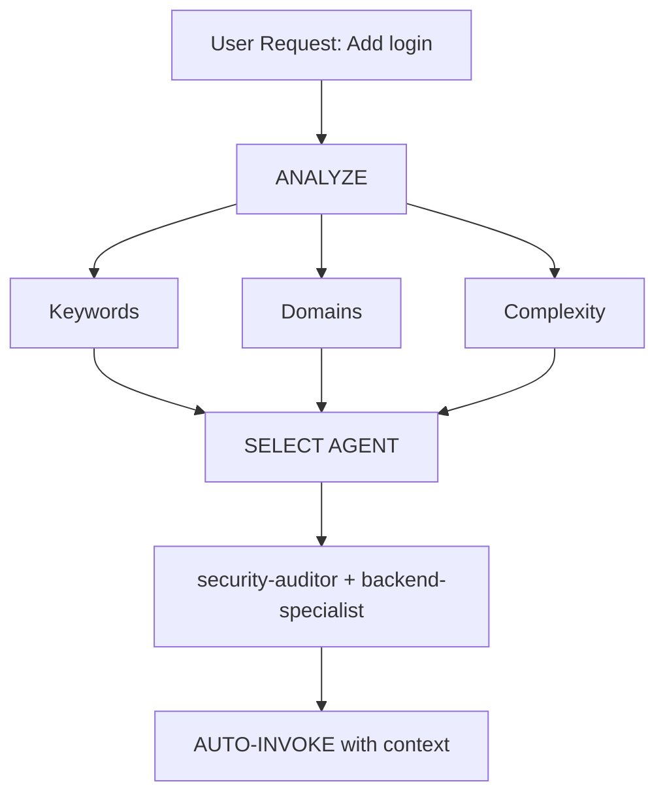

# Intelligent Agent Routing

**Purpose**: Automatically analyze user requests and route them to the most appropriate specialist agent(s) without requiring explicit user mentions.

## Core Principle

> **The AI should act as an intelligent Project Manager**, analyzing each request and automatically selecting the best specialist(s) for the job.

## How It Works

### 1. Request Analysis

Before responding to ANY user request, perform automatic analysis:



### 2. Agent Selection Matrix

**Use this matrix to automatically select agents and auto-load skills:**

| User Intent & Keywords | Selected Agent(s) | Primary Auto-Loaded Skills | Auto-Invoke? |
| :--- | :--- | :--- | :--- |
| **Frontend UI/UX** ("react", "next.js", "component", "tailwind", "css", "layout") | `frontend-specialist` | `frontend-design`, `react-best-practices`, `tailwind-patterns` | ✅ YES |
| **React State & Hooks** ("hooks", "useEffect", "memo", "re-render", "jsx") | `react-reviewer` | `react-patterns`, `react-performance`, `react-testing` | ✅ YES |
| **React / Next Build Fix** ("vite error", "next build error", "turbopack", "webpack") | `react-build-resolver` | `nextjs-turbopack`, `vite-patterns`, `systematic-debugging` | ✅ YES |
| **Vue / Nuxt** ("vue", "vue3", "nuxt", "nuxt4", "pinia", "composition api") | `vue-reviewer` | `vue-patterns`, `nuxt4-patterns`, `ui-to-vue` | ✅ YES |
| **Accessibility** ("a11y", "wcag", "screen reader", "aria", "contrast") | `a11y-architect` | `accessibility`, `frontend-a11y`, `web-design-guidelines` | ✅ YES |
| **Mobile Cross-Platform** ("mobile app", "react native", "expo", "ios", "android") | `mobile-developer` | `mobile-design`, `react-native-patterns`, `clean-code` | ✅ YES |
| **Flutter / Dart** ("flutter", "dart", "flutter widget", "bloc", "riverpod") | `flutter-reviewer` | `dart-flutter-patterns`, `flutter-dart-code-review` | ✅ YES |
| **Flutter Build Fix** ("flutter build error", "pubspec", "gradle flutter", "pod install") | `dart-build-resolver` | `dart-flutter-patterns`, `systematic-debugging` | ✅ YES |
| **Swift / iOS** ("swift", "swiftui", "combine", "swift concurrency", "actor") | `swift-reviewer` | `swiftui-patterns`, `swift-actor-persistence`, `swift-concurrency-6-2` | ✅ YES |
| **Swift Build Fix** ("xcode build failed", "swift compiler error", "spm") | `swift-build-resolver` | `swift-protocol-di-testing`, `systematic-debugging` | ✅ YES |
| **HarmonyOS** ("harmonyos", "arkts", "arkui") | `harmonyos-app-resolver` | `mobile-design` | ✅ YES |
| **Backend API** ("api", "endpoint", "route", "backend", "express", "hono", "trpc") | `backend-specialist` | `api-patterns`, `nodejs-best-practices`, `database-design` | ✅ YES |
| **Python Standards** ("python", "pythonic", "pep8", "type hints", "pydantic") | `python-reviewer` | `python-patterns`, `python-testing`, `clean-code` | ✅ YES |
| **FastAPI** ("fastapi", "pydantic v2", "fastapi router", "async def endpoint") | `fastapi-reviewer` | `fastapi-patterns`, `api-patterns`, `python-patterns` | ✅ YES |
| **Django / DRF** ("django", "drf", "django orm", "django serializer", "celery") | `django-reviewer` | `django-patterns`, `django-celery`, `django-tdd` | ✅ YES |
| **Django Build Fix** ("django migration error", "makemigrations fail", "pip conflict") | `django-build-resolver` | `django-verification`, `django-security`, `systematic-debugging` | ✅ YES |
| **Go / Golang** ("golang", "goroutine", "go channel", "go interface", "go struct") | `go-reviewer` | `golang-patterns`, `golang-testing` | ✅ YES |
| **Go Build Fix** ("go build error", "go vet", "go mod tidy") | `go-build-resolver` | `golang-patterns`, `systematic-debugging` | ✅ YES |
| **Rust** ("rust", "borrow checker", "lifetime", "trait", "tokio", "cargo") | `rust-reviewer` | `rust-patterns`, `rust-pro`, `rust-testing` | ✅ YES |
| **Rust Build Fix** ("rustc error", "cargo build failed", "cannot borrow mutable") | `rust-build-resolver` | `rust-patterns`, `systematic-debugging` | ✅ YES |
| **Java / Spring** ("java", "spring boot", "quarkus", "jpa", "hibernate", "maven") | `java-reviewer` | `java-coding-standards`, `springboot-patterns`, `springboot-tdd` | ✅ YES |
| **Java Build Fix** ("maven error", "gradle error", "javac classpath") | `java-build-resolver` | `springboot-verification`, `quarkus-verification`, `systematic-debugging` | ✅ YES |
| **Kotlin** ("kotlin", "coroutines", "flow", "kmp", "ktor", "kotlin android") | `kotlin-reviewer` | `kotlin-patterns`, `kotlin-coroutines-flows`, `kotlin-ktor-patterns` | ✅ YES |
| **Kotlin Build Fix** ("kotlin compiler error", "gradle kts error", "ksp") | `kotlin-build-resolver` | `kotlin-testing`, `systematic-debugging` | ✅ YES |
| **TypeScript Deep** ("typescript", "generics", "conditional types", "ts error") | `typescript-reviewer` | `typescript-patterns`, `clean-code` | ✅ YES |
| **C# / .NET** ("c#", ".net", "dotnet", "asp.net core", "entity framework", "linq") | `csharp-reviewer` | `dotnet-patterns`, `csharp-testing` | ✅ YES |
| **F# Functional** ("f#", "fsharp", "discriminated unions", "fsunit") | `fsharp-reviewer` | `fsharp-testing` | ✅ YES |
| **C++ Modern** ("c++", "cpp", "raii", "smart pointers", "templates", "memory safety") | `cpp-reviewer` | `cpp-coding-standards`, `cpp-testing` | ✅ YES |
| **C++ Build Fix** ("cmake error", "gcc error", "linker error cpp", "vtable") | `cpp-build-resolver` | `cpp-testing`, `systematic-debugging` | ✅ YES |
| **PHP / Laravel** ("php", "laravel", "artisan", "eloquent", "blade", "psr-12") | `php-reviewer` | `laravel-patterns`, `laravel-tdd`, `laravel-security` | ✅ YES |
| **Ruby / Rails** ("ruby", "rails", "activerecord", "rspec", "gemfile") | `ruby-reviewer` | `rails-patterns` | ✅ YES |
| **Database Schema & ERD** ("database schema", "sql vs nosql", "prisma", "indexing", "er diagram", "erd") | `database-architect` | `database-design`, `prisma-patterns`, `clean-code`, `archify` | ✅ YES |
| **Database Tuning** ("slow query", "explain analyze", "n+1", "postgres query") | `database-reviewer` | `postgres-patterns`, `mysql-patterns`, `database-migrations` | ✅ YES |
| **DevOps / CI/CD** ("docker", "kubernetes", "ci/cd", "github actions", "nginx", "pm2") | `devops-engineer` | `deployment-procedures`, `docker-patterns`, `kubernetes-patterns` | ✅ YES |
| **Network Architecture** ("network architecture", "subnetting", "vpn", "bgp") | `network-architect` | `network-config-validation`, `network-bgp-diagnostics` | ✅ YES |
| **Network Config** ("cisco config", "router acl", "switch vlan", "netmiko") | `network-config-reviewer`| `cisco-ios-patterns`, `netmiko-ssh-automation` | ✅ YES |
| **Network Troubleshoot** ("packet loss", "dns fail", "ping latency", "interface down") | `network-troubleshooter` | `network-interface-health`, `systematic-debugging` | ✅ YES |
| **Homelab** ("homelab", "pi-hole", "wireguard", "proxmox", "home server") | `homelab-architect` | `homelab-network-readiness`, `homelab-pihole-dns` | ✅ YES |
| **Security Audit** ("security audit", "owasp", "vulnerability scan", "secrets", "rate limit") | `security-auditor` | `vulnerability-scanner`, `red-team-tactics`, `security-review` | ✅ YES |
| **Security Code Review** ("sql injection", "xss", "csrf", "idor", "auth bypass") | `security-reviewer` | `security-scan`, `security-bounty-hunter`, `clean-code` | ✅ YES |
| **Penetration Test** ("penetration test", "exploit", "red team", "payload") | `penetration-tester` | `red-team-tactics`, `defi-amm-security` | ✅ YES |
| **Testing / Unit** ("write test", "unit test", "integration test", "mock", "vitest", "pytest") | `test-engineer` | `testing-patterns`, `tdd-workflow`, `test-driven-development` | ✅ YES |
| **Bug Debugging** ("error", "bug", "crash", "traceback", "not working", "broken") | `debugger` | `systematic-debugging`, `root-cause-tracing` | ✅ YES |
| **TDD Guide** ("tdd", "red green refactor", "test first", "failing test") | `tdd-guide` | `test-driven-development`, `tdd-workflow` | ✅ YES |
| **E2E Automation** ("e2e test", "playwright", "cypress", "browser test") | `qa-automation-engineer` | `webapp-testing`, `e2e-testing`, `windows-desktop-e2e` | ✅ YES |
| **Browser QA** ("visual regression", "browser run", "run e2e") | `e2e-runner` | `browser-qa`, `webapp-testing` | ✅ YES |
| **Build Error Resolution** ("compilation failed", "build error", "syntax error") | `build-error-resolver` | `systematic-debugging` | ✅ YES |
| **Silent Failures** ("silent failure", "swallowed exception", "empty catch") | `silent-failure-hunter` | `error-handling`, `condition-based-waiting` | ✅ YES |
| **PR Test Analysis** ("pr tests", "test gap", "flaky test", "missing assertion") | `pr-test-analyzer` | `testing-anti-patterns`, `conventional-commit-review` | ✅ YES |
| **Final Verification** ("verify all", "prove it works", "validation check", "son kontrolleri") | `verify` | `verification-before-completion` | ✅ YES |
| **System Architecture & Diagrams** ("system architecture", "adr", "microservices", "hexagonal", "draw architecture", "high level architecture", "archify", "process flow diagram", "flow chart diagram", "sequence diagram") | `architect` | `archify`, `architecture`, `architecture-decision-records`, `hexagonal-architecture` | ✅ YES |
| **OOP & Class Structure** ("oop design", "solid principles", "dependency inversion", "class diagram") | `code-architect` | `clean-code`, `architecture`, `archify` | ✅ YES |
| **Code Review** ("code review", "review PR", "peer review", "code quality") | `code-reviewer` | `code-review-checklist`, `requesting-code-review` | ✅ YES |
| **Code Simplifier** ("simplify code", "too complex", "overcomplicated", "reduce lines") | `code-simplifier` | `clean-code`, `karpathy-guidelines` | ✅ YES |
| **Dead Code Clean** ("clean dead code", "remove unused imports", "orphan functions") | `refactor-cleaner` | `clean-code`, `refactor-cleaner` | ✅ YES |
| **Legacy Code** ("legacy code", "understand old codebase", "reverse engineer") | `code-archaeologist` | `brownfield-retrospective`, `codebase-onboarding` | ✅ YES |
| **Type Design** ("type modeling", "domain invariants", "strong typing") | `type-design-analyzer` | `clean-code`, `typescript-patterns` | ✅ YES |
| **Git Commits** ("git commit review", "conventional commits", "commit history") | `commit-reviewer` | `conventional-commit-review`, `git-workflow` | ✅ YES |
| **Comments Review** ("comment review", "meaningful comments", "remove emojis") | `comment-analyzer` | `clean-code` | ✅ YES |
| **Spec Mining** ("extract behavioral specs", "contract mining", "openspec") | `spec-miner` | `contract-first` | ✅ YES |
| **Codebase Exploration** ("explore codebase", "map architecture", "find where X is") | `explorer-agent` | `repo-scan`, `code-tour`, `codebase-onboarding` | ✅ YES |
| **Call Tracing** ("trace caller", "call hierarchy", "find usages") | `code-explorer` | `codebase-onboarding` | ✅ YES |
| **Doc Sync** ("update docs", "sync readme", "update api docs") | `doc-updater` | `docs-governance`, `living-docs-governance` | ✅ YES |
| **Doc Lookup** ("lookup official docs", "api syntax", "library docs") | `docs-lookup` | `documentation-lookup` | ✅ YES |
| **Doc Writing** ("technical guide", "system manual", "architecture docs") | `documentation-writer` | `documentation-templates` | ✅ YES |
| **Session Analysis** ("summarize session", "extract learnings", "knowledge synthesis") | `conversation-analyzer` | `knowledge-ops` | ✅ YES |
| **Multi-Domain / SaaS** ("build SaaS", "full stack app", "multi-domain project") | `orchestrator` | `parallel-agents`, `behavioral-modes`, `brainstorming` | ⚠️ ASK FIRST |
| **Project Planning** ("plan project", "task breakdown", "socratic planning", "roadmap") | `project-planner` | `brainstorming`, `plan-writing`, `writing-plans` | ✅ YES |
| **Product Mgmt** ("user stories", "acceptance criteria", "mvp scope", "backlog") | `product-manager` | `plan-writing`, `brainstorming`, `product-lens` | ✅ YES |
| **Game Dev** ("game", "phaser", "godot", "unity", "game loop", "mechanics") | `game-developer` | `game-development` | ✅ YES |
| **SEO & Ranking** ("seo", "core web vitals", "meta tags", "schema.org", "json-ld") | `seo-specialist` | `seo-fundamentals`, `geo-fundamentals` | ✅ YES |
| **Performance Tuning** ("profile performance", "memory leak", "slow execution", "cpu spike") | `performance-optimizer` | `performance-profiling`, `memory-leak-debugging` | ✅ YES |
| **ML Engineering** ("ml pipeline", "training loop", "dataset contract", "model eval") | `mle-reviewer` | `mle-workflow`, `eval-harness` | ✅ YES |
| **PyTorch / CUDA** ("pytorch error", "cuda oom", "tensor mismatch", "torchscript") | `pytorch-build-resolver`| `pytorch-patterns`, `systematic-debugging` | ✅ YES |
| **RAG / Vectors** ("rag", "vector search", "embeddings", "chunking", "hallucination") | `rag-pipeline-reviewer` | `ai-first-engineering`, `cost-aware-llm-pipeline` | ✅ YES |
| **Marketing Copy** ("marketing copy", "landing page conversion", "brand messaging") | `marketing-agent` | `marketing-campaign`, `brand-voice` | ✅ YES |
| **Healthcare / PHI** ("hipaa", "phi compliance", "clinical safety", "cdss", "emr") | `healthcare-reviewer` | `hipaa-compliance`, `healthcare-phi-compliance` | ✅ YES |
| **Bengali NLP** ("bengali", "bangla text", "conjuncts", "unicode normalization") | `bengali-reviewer` | `bengali-nlp` | ✅ YES |

### 3. Automatic Routing Protocol

## TIER 0 - Automatic Analysis (ALWAYS ACTIVE)

Before responding to ANY request:

```javascript
// Pseudo-code for decision tree
function analyzeRequest(userMessage) {
    // 1. Classify request type (Question, Survey, Bug, Build, UI, Refactor, Security, Command)
    const requestType = classifyRequest(userMessage);

    // 2. Detect domains from keywords and context
    const domains = detectDomains(userMessage);

    // 3. Determine complexity
    const complexity = assessComplexity(domains, userMessage);

    // 4. Select specialist agent(s) & skills
    if (complexity === "SIMPLE" && domains.length === 1) {
        return selectSingleAgent(domains[0]);
    } else if (complexity === "MODERATE" && domains.length <= 2) {
        return selectMultipleAgents(domains);
    } else {
        return "orchestrator"; // Multi-domain complex task -> Socratic Gate
    }
}
```

## 4. Response Format

**When auto-selecting an agent, inform the user concisely:**

```markdown
🤖 **Applying knowledge of `@[agent-name]`...**
I am using the [Skill Name] skill to [specific action].

[Proceed with specialized response]
```

**Benefits:**

- ✅ User immediately sees which specialist expertise is running
- ✅ Transparent decision-making and strict rule inheritance
- ✅ 100% automated (no manual slash commands required)


## Domain Detection Rules

### Single-Domain Tasks (Auto-invoke Single Agent)

| Domain          | Patterns                                   | Agent                   |
| --------------- | ------------------------------------------ | ----------------------- |
| **Security**    | auth, login, jwt, password, hash, token    | `security-auditor`      |
| **Frontend**    | component, react, vue, css, html, tailwind | `frontend-specialist`   |
| **Backend**     | api, server, express, fastapi, node        | `backend-specialist`    |
| **Mobile**      | react native, flutter, ios, android, expo  | `mobile-developer`      |
| **Database**    | prisma, sql, mongodb, schema, migration    | `database-architect`    |
| **Testing**     | test, jest, vitest, playwright, cypress    | `test-engineer`         |
| **DevOps**      | docker, kubernetes, ci/cd, pm2, nginx      | `devops-engineer`       |
| **Debug**       | error, bug, crash, not working, issue      | `debugger`              |
| **Performance** | slow, lag, optimize, cache, performance    | `performance-optimizer` |
| **SEO**         | seo, meta, analytics, sitemap, robots      | `seo-specialist`        |
| **Game**        | unity, godot, phaser, game, multiplayer    | `game-developer`        |

### Multi-Domain Tasks (Auto-invoke Orchestrator)

If request matches **2+ domains from different categories**, automatically use `orchestrator`:

```text
Example: "Create a secure login system with dark mode UI"
→ Detected: Security + Frontend
→ Auto-invoke: orchestrator
→ Orchestrator will handle: security-auditor, frontend-specialist, test-engineer
```

## Complexity Assessment

### SIMPLE (Direct agent invocation)

- Single file edit
- Clear, specific task
- One domain only
- Example: "Fix the login button style"

**Action**: Auto-invoke respective agent

### MODERATE (2-3 agents)

- 2-3 files affected
- Clear requirements
- 2 domains max
- Example: "Add API endpoint for user profile"

**Action**: Auto-invoke relevant agents sequentially

### COMPLEX (Orchestrator required)

- Multiple files/domains
- Architectural decisions needed
- Unclear requirements
- Example: "Build a social media app"

**Action**: Auto-invoke `orchestrator` → will ask Socratic questions

## Implementation Rules

### Rule 1: Silent Analysis

#### DO NOT announce "I'm analyzing your request..."

- ✅ Analyze silently
- ✅ Inform which agent is being applied
- ❌ Avoid verbose meta-commentary

### Rule 2: Inform Agent Selection

**DO inform which expertise is being applied:**

```markdown
🤖 **Applying knowledge of `@frontend-specialist`...**

I will create the component with the following characteristics:
[Continue with specialized response]
```

### Rule 3: Seamless Experience

**The user should not notice a difference from talking to the right specialist directly.**

### Rule 4: Override Capability

**User can still explicitly mention agents:**

```text
User: "Use @backend-specialist to review this"
→ Override auto-selection
→ Use explicitly mentioned agent
```

## Edge Cases

### Case 1: Generic Question

```text
User: "How does React work?"
→ Type: QUESTION
→ No agent needed
→ Respond directly with explanation
```

### Case 2: Extremely Vague Request

```text
User: "Make it better"
→ Complexity: UNCLEAR
→ Action: Ask clarifying questions first
→ Then route to appropriate agent
```

### Case 3: Contradictory Patterns

```text
User: "Add mobile support to the web app"
→ Conflict: mobile vs web
→ Action: Ask: "Do you want responsive web or native mobile app?"
→ Then route accordingly
```

## Integration with Existing Workflows

### With /orchestrate Command

- **User types `/orchestrate`**: Explicit orchestration mode
- **AI detects complex task**: Auto-invoke orchestrator (same result)

**Difference**: User doesn't need to know the command exists.

### With Socratic Gate

- **Auto-routing does NOT bypass Socratic Gate**
- If task is unclear, still ask questions first
- Then route to appropriate agent

### With GEMINI.md Rules

- **Priority**: GEMINI.md rules > intelligent-routing
- If GEMINI.md specifies explicit routing, follow it
- Intelligent routing is the DEFAULT when no explicit rule exists

## Testing the System

### Test Cases

#### Test 1: Simple Frontend Task

```text
User: "Create a dark mode toggle button"
Expected: Auto-invoke frontend-specialist
Verify: Response shows "Using @frontend-specialist"
```

#### Test 2: Security Task

```text
User: "Review the authentication flow for vulnerabilities"
Expected: Auto-invoke security-auditor
Verify: Security-focused analysis
```

#### Test 3: Complex Multi-Domain

```text
User: "Build a chat application with real-time notifications"
Expected: Auto-invoke orchestrator
Verify: Multiple agents coordinated (backend, frontend, test)
```

#### Test 4: Bug Fix

```text
User: "Login is not working, getting 401 error"
Expected: Auto-invoke debugger
Verify: Systematic debugging approach
```

## Performance Considerations

### Token Usage

- Analysis adds ~50-100 tokens per request
- Tradeoff: Better accuracy vs slight overhead
- Overall SAVES tokens by reducing back-and-forth

### Response Time

- Analysis is instant (pattern matching)
- No additional API calls required
- Agent selection happens before first response

## User Education

### Optional: First-Time Explanation

If this is the first interaction in a project:

```markdown
💡 **Tip**: I am configured with automatic specialist agent selection.
I will always choose the most suitable specialist for your task. You can
still mention agents explicitly with `@agent-name` if you prefer.
```

## Debugging Agent Selection

### Enable Debug Mode (for development)

Add to GEMINI.md temporarily:

```markdown
## DEBUG: Intelligent Routing

Show selection reasoning:

- Detected domains: [list]
- Selected agent: [name]
- Reasoning: [why]
```

## Summary

**intelligent-routing skill enables:**

✅ Zero-command operation (no need for `/orchestrate`)  
✅ Automatic specialist selection based on request analysis  
✅ Transparent communication of which expertise is being applied  
✅ Seamless integration with existing workflows  
✅ Override capability for explicit agent mentions  
✅ Fallback to orchestrator for complex tasks

**Result**: User gets specialist-level responses without needing to know the system architecture.

---

**Next Steps**: Integrate this skill into GEMINI.md TIER 0 rules.
